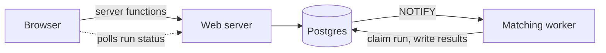

# HLA-Trans

A demonstration of heart donor–recipient compatibility review. It captures patient and donor records, checks six rule groups with explainable PASS / REVIEW / FAIL findings, supports versioned criteria, matches every new patient or donor in the background, and saves match results and clinician decisions with snapshots and an audit trail.

**Demo environment: synthetic records. Not for clinical use. This is not a validated medical device or clinical decision system.** The app advises; a qualified clinician makes the final decision. Missing or unknown clinically relevant inputs require review. Thresholds include center-practice assumptions and need clinical sign-off. Screening order is **not OPTN allocation** and does not implement national match runs.

## Requirements

- Bun ≥ 1.4
- Podman with `podman compose`

## Run locally

```sh
cp .env.example .env
bun install --frozen-lockfile
bun run db:up        # Postgres 18: dev on :5442, tests on :5444
bun run db:migrate
bun run db:seed      # optional: 24 patients, 12 donors, queues match runs
bun run dev          # web on http://localhost:3000 + the matching worker
```

## Test

```sh
bun run typecheck
bun run lint
bun run test          # unit tests
bun run test:db       # needs the postgres-test container
bun run perf          # load test against PERF_DATABASE_URL (truncates it)
bun run check:bundle  # build, then fail if server code reaches the client
```

`bun scripts/load-test.ts --seed-only --wipe-dev-data` fills the dev database with 2,000 patients and 500 donors. It deletes all dev data first.

## Architecture

The pure domain engine (`src/domain`) is shared by three callers: the browser (live preview in Check a pair), TanStack Start server functions (authoritative writes), and a separate worker process (match runs). Postgres holds the records (validated `jsonb` plus indexed summary columns), immutable snapshots, match results, the audit log, and the job queue (`FOR UPDATE SKIP LOCKED` + `LISTEN/NOTIFY`). Saving a patient or donor queues a match run in the same transaction. Pages load through TanStack Query, warmed by route loaders and rendered on the server.



Audit log, match results, criteria versions, snapshots and decisions are append-only (database triggers). Clinician name and theme are stored per browser in cookies.

See the [v2 specification](docs/specs/2026-11-14-v2-postgres-matching-ux-spec.md) and the [v1 specification](docs/specs/2026-11-14-heart-compatibility-spec.md) for safety rules (§3).

## Backups

```sh
podman compose exec postgres pg_dump -U postgres main > backup.sql
podman compose exec -T postgres psql -U postgres main < backup.sql
```

The in-app export (Data screen) is a record-level JSON file for review. The in-app import accepts v1 browser exports, and a banner offers a one-click import of records left in this browser's localStorage by the old version.

## Records and decisions

Saved match results keep copies of the patient, donor, criteria, pair inputs and results used at that time. Later edits mark them "Out of date" instead of rewriting them. Final decisions are only possible on checked pairs (with pair inputs) and require a clinician, rationale, and acknowledgement of FAIL/REVIEW findings; decline also requires a reason.
