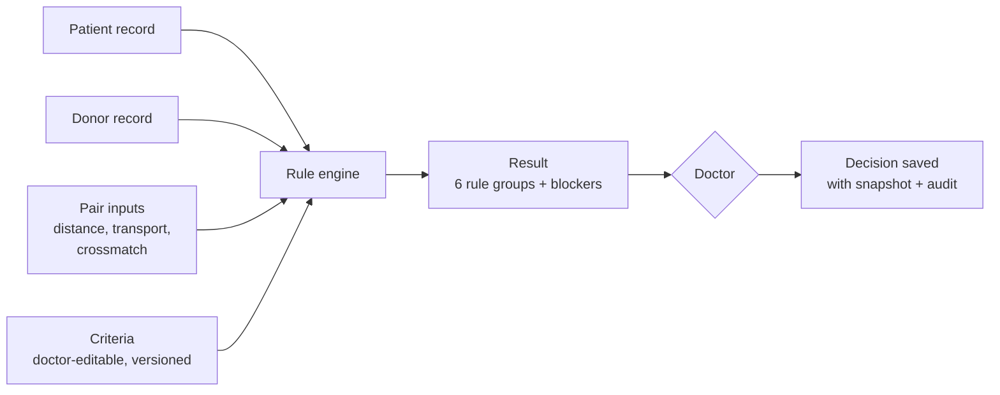
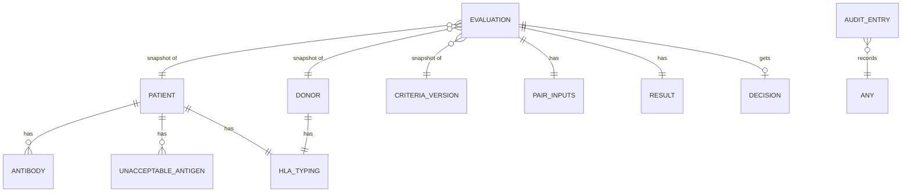
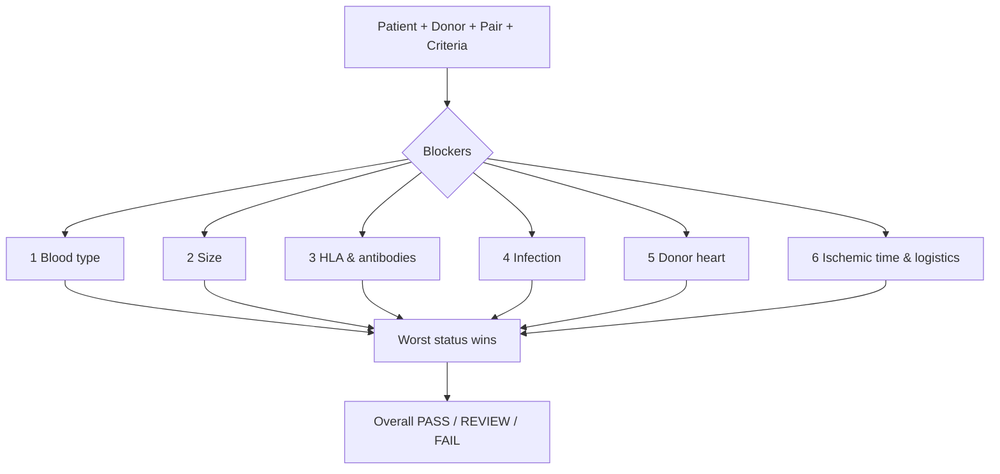
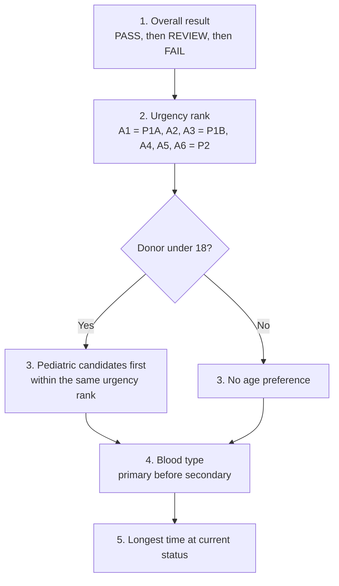
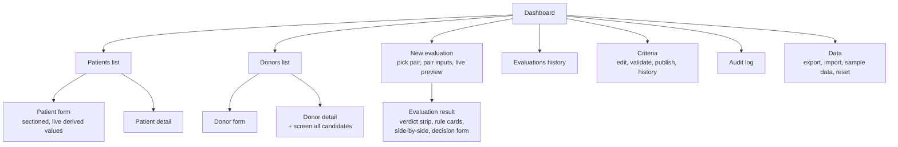

# HLA-Trans: Heart Donor–Recipient Compatibility (Spec v1)

Status: **Draft for review**
Date: 2026-11-14
Owner: Abdul Rehman

---

## 1. Purpose

A demo web app that helps a heart transplant team decide if a donor heart suits a specific patient.

- The app **checks** a donor against a patient across 6 rule groups and shows PASS / REVIEW / FAIL with reasons and sources.
- A **doctor makes the final decision** (accept / decline / defer). The app never decides.
- All data is entered **by hand** and stored **in the browser** (localStorage).

### 1.1 Goals
1. Capture every field a heart team reviews for a donor and a candidate (per OPTN forms and ISHLT guidelines).
2. Run a transparent, explainable compatibility check.
3. Let doctors tune every threshold, with version history.
4. Keep an immutable record of every evaluation and decision.

### 1.2 Non-goals (out of scope for v1)
| Not doing | Why |
|---|---|
| OPTN allocation / match-run ranking | Needs national data and acuity-circle distances. The app shows a simple screening order only, labelled as not OPTN allocation. |
| Computing cPRA | Needs OPTN population genotype frequency tables. cPRA is **entered as reported** by the lab. |
| Login, roles, multi-user | Demo. Clinician name is typed and recorded on each action. |
| Backend / database | localStorage only. Storage sits behind one module so a backend can replace it later. |
| Real patient data | Demo only. A banner says so. |
| Pediatric-specific scoring beyond weight ratio and ABO-incompatible pathway | Evidence base differs. Flagged as REVIEW where relevant. |

---

## 2. Users

| User | Needs |
|---|---|
| Transplant cardiologist / surgeon | See the verdict fast, see why, make and record a decision |
| Transplant coordinator | Enter donor and patient data quickly, run checks, track offers |
| Program director | Set the criteria, see the history of changes |

Single-user app. Each write records the clinician name set in the app header.

---

## 3. Core rules of behaviour (safety)

These rules apply everywhere and override convenience.

1. **Missing data is never a pass.** A missing input produces a REVIEW finding marked "Missing data".
2. **Unknown is not No.** History fields use Yes / No / Unknown. "Unknown" is treated like missing where it matters.
3. **Worst result wins.** Rule status = worst finding. Overall = worst rule or blocker.
4. **Evaluations are frozen.** Each evaluation stores copies of the patient, donor and criteria used. Later edits never change past results.
5. **Every finding explains itself.** Title, plain-language detail, the measured value ("evidence") and the source (guideline or "center practice").
6. **No silent data loss.** Corrupt storage is backed up before reset. Storage-full errors are shown to the user.
7. **The app advises, the doctor decides.** A decision needs the clinician name, a written reason, and confirmation that all FAIL/REVIEW findings were read.

---

## 4. Data model

All numbers are stored in one fixed unit (shown in the UI). `null` means "not recorded". Dates are ISO `YYYY-MM-DD`.

### 4.1 Patient (candidate)

| Section | Fields |
|---|---|
| Identity | MRN*, first name*, last name*, date of birth*, sex*, ethnicity (OPTN ETHCAT), transplant center, attending physician |
| Listing | state (active / inactive / under evaluation / transplanted / removed), listing date, urgency status (Adult 1–6, Pediatric 1A/1B/2), status criterion, status date, status expiry, multi-organ flag + organs |
| Body | height (cm), weight (kg) → derived BMI, BMI class, BSA (Mosteller, DuBois), predicted heart mass (LV, RV, total) |
| Blood type | ABO, subtype, verified by 2 samples (OPTN 3.3), accepts ABO-incompatible (pediatric), anti-A titer, anti-B titer, titer date, titer-lowering therapy within 30 days |
| Diagnosis | primary diagnosis (OPTN TCR codes 1000–1497, congenital 1203–1207), detail, diagnosis date |
| Hemodynamics (right heart cath) | cath date, PA systolic / diastolic / mean, PCWP, RAP, cardiac output, cardiac index, SBP, MAP, SvO₂, on inotropes during cath, vasodilator challenge done, PVR after challenge → derived TPG, DPG, PVR, PVRI, CI (if not measured) |
| Support | MCS device (none, IABP, percutaneous, VA-ECMO, durable LVAD, non-dischargeable LVAD, BiVAD, RVAD, TAH), brand, implant date, inotropes (agent + dose), mechanical ventilation, inhaled NO, ICD |
| Function | LVEF, NYHA class, peak VO₂, on beta-blocker, hospitalized, in ICU |
| Labs | lab date, creatinine, eGFR, dialysis, bilirubin, albumin, INR, AST, ALT, sodium, BNP, NT-proBNP, HbA1c, hemoglobin, lactate |
| History | diabetes + end-organ damage, prior sternotomies (count), prior cardiac surgery, malignancy, cerebrovascular disease, PVD, smoking + quit date, substance use, frailty, psychosocial concerns |
| Sensitization | cPRA (current, peak, date), pregnancies, transfusions band, prior transplants, prior homograft, desensitization notes, **antibody list** (antigen, MFI, C1q, test date), **unacceptable antigens** |
| HLA typing | A, B, C, DRB1, DRB3/4/5, DQA1, DQB1, DPA1, DPB1 (2 each), Bw4, Bw6, typing date, method |
| Serology | HIV, HBsAg, anti-HBc, anti-HBs, anti-HCV, HCV NAT, CMV IgG, EBV IgG, Toxoplasma IgG, VZV IgG, Chagas, TB; serology date; enrolled in HIV research protocol (HOPE) |
| Offer acceptance criteria | max donor age, min/max donor weight, max distance (NM), accept DCD, accept HCV NAT+, accept HCV Ab+, accept anti-HBc+, accept HBV NAT+, accept PHS risk |
| Notes | free text |

### 4.2 Donor

| Section | Fields |
|---|---|
| Identity | donor ID*, state (available / allocated / declined / closed), donor hospital, OPO, referral date, age (years), sex, ethnicity |
| Body | height, weight → BMI, BSA, PHM |
| Blood type | ABO, subtype, verified by 2 samples |
| Donation | DBD / DCD, brain death date; DCD: recovery technique (DPP, TA-NRP, DP-HOPE), agonal phase min, functional warm ischemia min, no-touch min |
| Death | cause, mechanism, circumstance (OPTN DDR codes), CO poisoning + COHb %, cardiac arrest, CPR minutes, unexplained sudden death |
| History | hypertension (duration band), diabetes (band) + insulin, cigarettes >20 pack-years, cocaine, amphetamines, IV drug use, heavy alcohol, prior MI, known CAD, prior cardiac surgery, malignancy risk tier + detail, transfusions this admission, born in Chagas-endemic country, **PHS 2020 risk criteria (10 checkboxes)** |
| Hemodynamics & support | HR, SBP, MAP, CVP, PCWP, CI, CO, temperature, vasoactive drugs (agent + dose), thyroid hormone, steroids, ECMO (none / VV / VA weaned / VA ongoing) |
| Echo | date, LVEF, method, repeat LVEF, septum mm, posterior wall mm, wall motion, valve disease, RV function, congenital abnormality |
| Coronary | angiography (not done / normal / abnormal), vessels >50%, left main disease, coronary anomaly |
| ECG | LVH criteria, ischemic changes, significant arrhythmia, QTc |
| Labs | sodium peak + latest, troponin I peak, troponin T peak, CK-MB, BNP, creatinine, lactate, pH, PaO₂, FiO₂, hemoglobin, glucose, AST, ALT, bilirubin |
| Infection | OPTN 2.9 panel (HIV Ab/Ag, HIV NAT, HBsAg, anti-HBc, HBV NAT, anti-HCV, HCV NAT, CMV, EBV, syphilis, Toxoplasma, Strongyloides, Chagas, WNV, SARS-CoV-2), sample within 96 h, blood culture positive + targeted therapy, CNS infection, chest X-ray |
| HLA typing | same grid as patient |
| Notes | free text |

### 4.3 Pair inputs (per evaluation)
distance (NM), procurement minutes, transport minutes, implant minutes, preservation method (static cold, controlled hypothermic, HOPE, normothermic OCS), perfusion minutes, flow crossmatch, CDC crossmatch.

### 4.4 Criteria version
`version` (1, 2, 3…), author, change note, created at, full criteria object. Publishing creates a new version. Old versions are read-only.

### 4.5 Evaluation
patient + donor + criteria **snapshots**, pair inputs, result, decision (verdict, reason codes, clinician, rationale, acknowledged flag, time).

### 4.6 Audit log
Every create / update / delete / evaluation / decision / criteria publish / import / reset, with time, actor, subject and summary.

---

## 5. Derived calculations

| Value | Formula | Source |
|---|---|---|
| BMI | kg / m² | WHO |
| BSA (Mosteller) | √(cm × kg / 3600) | Mosteller 1987 |
| BSA (DuBois) | 0.007184 × kg^0.425 × cm^0.725 | DuBois 1916 |
| LV mass (g) | a × H(m)^0.54 × W(kg)^0.61; a = 8.25 M, 6.82 F | Reed 2014 |
| RV mass (g) | a × age^−0.32 × H(m)^1.135 × W^0.315; a = 11.25 M, 10.59 F | Reed 2014 |
| PHM | LV + RV | Reed 2014 |
| PHM ratio | donor PHM / recipient PHM | Kransdorf 2019 |
| TPG | mPAP − PCWP | ISHLT 2016 |
| DPG | PA diastolic − PCWP | — |
| PVR (WU) | TPG / CO | ISHLT 2016 |
| PVRI | TPG / CI | ISHLT 2016 |
| mPAP (if missing) | dia + (sys − dia)/3 | standard estimate, flagged as derived |
| CI (if missing) | CO / BSA (Mosteller) | flagged as derived |
| Est. ischemic time | procurement + transport + implant + redo-sternotomy extra + device-explant extra | Copeland 2023 (components) |
| Cold ischemic time | total − normothermic perfusion minutes (OCS only) | — |

**PHM test vectors** (Reed 2014 worked example; age 55, 175 cm, 80 kg):
male LV 161.65, RV 23.42, total 185.07 g. Female LV 133.63, RV 22.04, total 155.68 g.

---

## 6. Rule engine

Six rule groups plus engine-level blockers.

Finding statuses: `pass`, `info` (counts as pass), `review`, `fail`. Each finding: code, status, missing flag, title, detail, evidence, source.

### 6.0 Blockers
| Condition | Result |
|---|---|
| Patient state ≠ active | FAIL: "Candidate is not active on the waitlist" |
| Donor state ≠ available | FAIL: "Donor is not available" |

### 6.1 Blood type (ABO)
| Case | Result |
|---|---|
| Either ABO missing | REVIEW (missing) |
| Either not verified by 2 samples | REVIEW |
| Identical | PASS |
| Compatible, not identical (O→A/B/AB, A→AB, B→AB) | PASS + info on OPTN priority (donor O: O and B primary, A and AB secondary) |
| Incompatible, pediatric pathway allowed, patient opted in, age < 1 y | REVIEW ("intended incompatible, any titer") |
| Incompatible, pediatric (<18), age ≥ 1 y: required titers present, ≤ 1:16, dated ≤ 30 days, no titer-lowering therapy in 30 days | REVIEW |
| Same, but titers missing or older than 30 days | REVIEW (missing) |
| Same, but titer too high or recent therapy | FAIL |
| Any other incompatible | FAIL |

Required titers by recipient type: A → anti-B; B → anti-A; O → both (OPTN 6.6.B).
Subtypes are shown as info only. OPTN heart allocation does not use subtypes.

### 6.2 Size
**Adult recipient (≥ 18):**
| Case | Result |
|---|---|
| PHM computable for both | use PHM ratio below |
| ratio ≥ 0.86 and ≤ 1.30 | PASS |
| 0.70 ≤ ratio < 0.86 | REVIEW (undersized) |
| ratio < 0.70 | FAIL |
| ratio > 1.30 | REVIEW (oversized) |
| Recipient PVR > 4 WU and ratio < 1.00 | at least REVIEW ("pulmonary hypertension: larger donor advised") |
| PHM not computable | fall back to weight ratio: ≥ 0.80 PASS, 0.70–0.80 REVIEW, < 0.70 FAIL; female→male < 0.80 REVIEW |
| Weight also missing | REVIEW (missing) |

PVR used = post-vasodilator PVR if a challenge was done, otherwise derived PVR.
The weight ratio and female→male flag are always shown as info when PHM is used.

**Pediatric recipient (< 18):** weight ratio 0.6–3.0 → PASS, outside → FAIL. PHM shown as info (extrapolated).

**Candidate filters:** donor weight outside the patient's min/max → FAIL.

### 6.3 HLA and antibodies (virtual crossmatch)
Equivalence per WHO broad/split tables with OPTN 4.11 overrides (B15 ⊃ B70/B71/B72, A10 ⊃ A43, B*40:05 ≡ B50/B21).

| Case | Result |
|---|---|
| Donor carries a listed unacceptable antigen | FAIL (configurable) |
| Donor typing too low-resolution to exclude an unacceptable antigen | REVIEW |
| DSA with MFI ≥ 5000 | FAIL |
| DSA with MFI 2000–4999 | REVIEW |
| DSA C1q positive | FAIL (configurable) |
| Possible DSA (low-resolution typing), MFI ≥ 2000 | REVIEW |
| Antibodies < 2000 MFI | ignored, count shown as info |
| Patient has antibodies/unacceptables but donor not typed | REVIEW (missing) |
| No antibody data and cPRA missing | REVIEW (missing) |
| cPRA > 10% but no antibody specificities listed | REVIEW (missing) |
| cPRA ≤ 10%, no antibodies | PASS |
| CDC crossmatch positive | FAIL (configurable) |
| Flow crossmatch positive | REVIEW (configurable) |
| Invalid HLA entries | REVIEW |
| Donor null alleles (N) | info, excluded from the antigen set |
| A/B/DR mismatch count | info |

Matching levels:
- **Broad target** (e.g. A9) matches any donor split (A23, A24).
- **Split target** (A24) matches donor A24. If the donor is typed only as broad A9 → "possible".
- **Allele target** (A*24:02) matches donor A*24:02. A donor typed at serologic level only → "possible". A donor typed at 2-field resolution without it → no match.
- **Bw4/Bw6** from explicit typing, or derived from B antigens (WHO lists).

### 6.4 Infection
| Case | Default |
|---|---|
| Any OPTN-required donor test "not done" | REVIEW (missing), one per test |
| Chagas required (endemic birth) but not done | REVIEW (missing) |
| Sample not drawn within 96 h | REVIEW |
| Indeterminate result | REVIEW |
| Donor HIV+ | FAIL. REVIEW if recipient HIV+ **and** in research protocol (HOPE) |
| HCV NAT+ | REVIEW (DAA + consent). FAIL if patient opted out |
| Anti-HCV+, NAT− | REVIEW. FAIL if opted out |
| HBsAg+ or HBV NAT+ | REVIEW. FAIL if patient opted out of HBV NAT+ |
| Anti-HBc+ only | REVIEW. FAIL if opted out |
| CMV D+/R− | REVIEW (high risk); D+/R+, D−/R+ info (intermediate); D−/R− info (low) |
| EBV D+/R− | REVIEW (PTLD risk) |
| Toxoplasma D+/R− | REVIEW (prophylaxis) |
| Chagas+ | FAIL |
| Strongyloides+ | REVIEW (treat recipient) |
| Syphilis+ | REVIEW |
| WNV+ | FAIL |
| Positive blood culture | REVIEW |
| Viral/fungal/amebic CNS infection | FAIL; untreated bacterial meningitis REVIEW; treated → info |
| Any PHS risk criterion | REVIEW (disclosure). FAIL if patient opted out |
| Recipient CMV / EBV / Toxo not done | REVIEW (missing) |

### 6.5 Donor heart
| Check | Default |
|---|---|
| Age missing | REVIEW (missing) |
| Age > patient's max donor age | FAIL |
| Age > fail limit (default: none) | FAIL |
| Age > 45 | REVIEW (CAD screening needed) |
| LVEF (repeat value if present) ≥ 50 | PASS; 40–49 REVIEW; < 40 FAIL |
| Wall motion abnormal | REVIEW |
| Max wall thickness ≤ 13 mm | PASS; 14–16 REVIEW; ≥ 17 FAIL |
| ECG LVH + thickness > 13 | REVIEW |
| Valve disease moderate/severe | FAIL (configurable) |
| RV function moderate/severe | REVIEW |
| Congenital abnormality | REVIEW |
| Coronary anomaly | FAIL (Class III) |
| Angio abnormal: left main or ≥ 2 vessels | FAIL (configurable); 1 vessel REVIEW; 0 vessels PASS |
| Angio not done but indicated (male > 40, female > 45, cocaine, diabetes, > 20 pack-years) | REVIEW (missing) |
| Known CAD / prior MI / prior cardiac surgery | REVIEW |
| Sodium < 129 or ≥ 170 | FAIL; < 135 or > 155 REVIEW |
| Norepinephrine alone ≤ 0.1 | PASS; above REVIEW |
| Dopamine > 10 | REVIEW |
| ≥ 2 vasoactive agents (vasopressin excluded) | REVIEW |
| Agent with no dose | REVIEW (missing) |
| VA-ECMO ongoing | FAIL; VV or VA weaned info |
| Cardiac arrest: CPR > 30 min with LVEF < 50 | REVIEW; CPR minutes missing REVIEW (missing) |
| Troponin I > 1.0 ng/mL | REVIEW (consider angiography) |
| CO poisoning: COHb > 40%, troponin ≥ 0.7, ischemic ECG, or LVEF < 50 | FAIL |
| Malignancy: high FAIL; intermediate REVIEW; unknown REVIEW (missing) | |
| Cocaine + wall thickness ≥ 14 | REVIEW |
| Donor > 45 and recipient < 45 | info ("older donors may suit older or highly sensitized recipients", Copeland 2023) |
| Unexplained sudden death | REVIEW (screen for HCM, long QT, Brugada, coronary anomaly) |

### 6.6 Ischemic time and logistics
| Check | Default |
|---|---|
| Any time component missing | REVIEW (missing) |
| Cold ischemic ≤ 240 min | PASS; ≤ 360 REVIEW; > 360 FAIL |
| Donor > 45 and total > 240 min | at least REVIEW |
| Machine perfusion used | info |
| DCD and patient does not accept DCD | FAIL |
| DCD functional warm ischemia ≤ 30 | PASS; ≤ 45 REVIEW; > 45 FAIL; missing REVIEW (missing) |
| DCD recovery technique missing | REVIEW (missing) |
| Distance > patient max distance | FAIL |

All numbers above are **defaults**. Every one is editable in Criteria.

### 6.7 Screening order (donor → all candidates)

Used only on the donor "Screen candidates" view. Simplified from OPTN Policy 6.6 (Tables 6-4, 6-7, 6-8). Distance circles are **not** applied (no hospital locations in v1). Always labelled "Screening order, not OPTN allocation".

| Step | Rule | Source |
|---|---|---|
| 1 | Overall engine result: PASS → REVIEW → FAIL | App design |
| 2 | Urgency rank. Equal ranks: A1 = P1A, A3 = P1B, A6 = P2 | OPTN Table 6-7 groupings |
| 3 | Donor < 18: pediatric candidates before adults at the same rank | OPTN Table 6-8 |
| 4 | ABO priority: donor O → O and B primary, A and AB secondary; other donors: compatible = primary | OPTN Table 6-4 |
| 5 | Time at current status, longest first (from status date; listing date if status date is missing, flagged) | OPTN 6.5 |

**Pediatric candidate** = registered before age 18: age at listing date < 18, or current age < 18 if no listing date (OPTN 6.1–6.2).

**Not used:** recipient age for adults. OPTN heart allocation has no adult age priority. Older donor hearts suiting older recipients is shown as an info finding in the donor heart rule, not as ranking.

---

## 7. Screens

| Screen | Key behaviour |
|---|---|
| Dashboard | counts (active patients, available donors, pending decisions), recent evaluations, storage usage, demo banner |
| Lists | search, filter by state / ABO, sort, empty states with a clear next action |
| Forms | sections with side navigation, units in every numeric field, inline validation, derived values live (BMI, BSA, PHM, PVR), unsaved-change guard, Yes/No/Unknown controls |
| HLA grid | 9 loci × 2 cells, normalizes on blur (e.g. `2` in A → `A2`, `02:01` → `A*02:01`), shows invalid entries |
| Antibody table | add/remove rows, MFI, C1q, date; paste a list ("A2 8000, B44 3500") |
| Donor detail → Screen | runs the engine against every active patient; sorted per §6.7 (result, urgency, pediatric priority for pediatric donors, ABO priority, time at status); shows "time at status" and "pediatric" columns; labelled "Screening order, not OPTN allocation" |
| Evaluation result | overall verdict, 6-segment status strip, each rule expandable with findings, missing-data list, donor vs patient side-by-side, ischemic time breakdown, decision form |
| Criteria | grouped fields with source text, cross-field validation, change note required, publishes new version, version list with field-level diff |
| Data | export JSON, import JSON (validated, replace with confirmation), load sample data, reset with typed confirmation |

### 7.1 Visual design
- Style: dense clinical tool, sharp corners (existing shadcn "lyra" style), IBM Plex Sans (UI), IBM Plex Mono for HLA strings only, tabular numbers.
- Colour: petrol-blue primary. Status colours used **only** for status: green pass, amber review, red fail, slate missing/unknown.
- Status is never colour-only: every status also has an icon and a word.
- Light and dark themes. Keyboard focus visible. Respects reduced motion.

---

## 8. Non-functional requirements

| Area | Requirement |
|---|---|
| Stack | TanStack Start (React 19), shadcn (Base UI, lyra), Tailwind v4, zod 4, vitest |
| Storage | one localStorage key `hla-trans.db.v1`, zod-validated on read and write, schema version field, cross-tab sync, corrupt-data backup, quota error surfaced |
| Rendering | **SSR off.** `defaultSsr: false` in `src/start.ts` and SPA mode in the Vite plugin. Only the HTML shell (head, fonts, CSS) comes from the server; every page renders in the browser. Data comes from localStorage, so the server has nothing to render. The build outputs a static shell that any static host can serve. |
| Performance | engine runs < 5 ms per pair; screening 200 patients < 1 s |
| Testing | unit tests for every calculation, HLA function and rule branch; seed data test asserting expected verdicts |
| Quality gates | `tsc --noEmit`, eslint, vitest all pass before each commit |
| Accessibility | labelled controls, error text linked to fields, status text + icon, contrast AA |
| Privacy | demo banner; no network calls with record data |

---

## 9. Open items needing clinical sign-off

These defaults are reasonable but **not settled by guidelines**. A clinician should confirm them before any real use.

| # | Item | Default chosen | Conflict / gap |
|---|---|---|---|
| 1 | PHM pass threshold | 0.86 | Copeland 2023 also says "within 20–30% acceptable" and "lower survival >10–15%" |
| 2 | DSA MFI cut-offs | review 2000, fail 5000 | No consensus (STAR 2017). Center-specific |
| 3 | Troponin review level | 1.0 ng/mL | Guideline: not a reason to decline alone |
| 4 | Ischemic fail limit | 360 min | Guideline gives a target (≤ 240), not a hard limit |
| 5 | Donor age fail limit | none | Guideline: no upper limit |
| 6 | Vasoactive "multiple agents" | ≥ 2 agents | No guideline number |
| 7 | Redo / explant extra minutes | 45 / 60 | Center estimate |
| 8 | ISHLT 2023 recipient guideline and 2024 candidate guideline | not read in full | Paywalled; may update thresholds |
| 9 | OPTN tables after 11/13/2025 | not checked | Re-verify broad/split overrides yearly |

---

## 10. Sources
- OPTN Policies (effective 11/13/2025): 2.9, 3.3, 4.3–4.11, 5.3, 6.1–6.6, 15
- Copeland H et al. Donor heart selection guideline. JHLT 2023;42:7–29
- Mehra MR et al. ISHLT listing criteria. JHLT 2016;35:1–23
- Reed RM et al. Predicted heart mass. JACC HF 2014;2:73–83
- Kransdorf EP et al. PHM ratio. JHLT 2019;38:156–165
- Tao et al. JAMA Netw Open 2023 (PHM and PVR)
- Jones JM et al. PHS Guideline 2020. MMWR 69(4)
- Kotton CN et al. CMV consensus. Transplantation 2025
- AST IDCOP guidelines 2019 (EBV, HBV, Toxoplasma, Strongyloides)
- Aslam S et al. ISHLT HCV consensus. JHLT 2020
- Chin-Hong PV et al. Chagas and transplant. AJT 2011
- Kirk R et al. ISHLT pediatric consensus. JHLT 2020
- WHO HLA nomenclature (hla.alleles.org, 2026)
